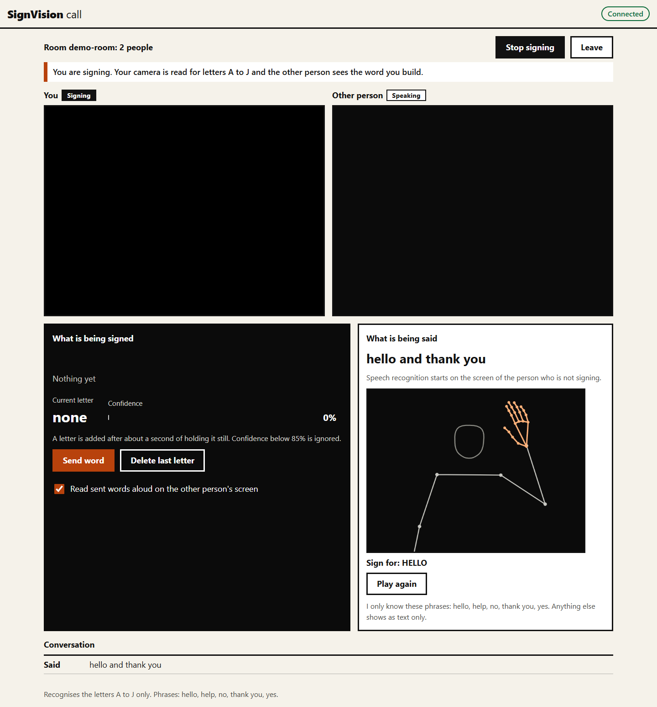

# SignVision AI

I built this to see how far a small model on hand landmarks could go for Indian Sign Language fingerspelling, and to put it inside a video call where one person can be deaf. MediaPipe finds 21 hand points in each webcam frame, a small neural network guesses the letter, and a word builder turns the noisy per-frame guesses into words. In the call, the signed word is shown as large captions (and read aloud) on the hearing person's screen. When the hearing person speaks, any phrase I recorded (hello, help, no, thank you, yes) is replayed as an animated hand and arm skeleton for the deaf person.

It knows the letters A to J and five phrases. That is all. See Limits.



## Run it

Python 3.10.

```bash
python -m venv .venv
.venv\Scripts\activate            # macOS/Linux: source .venv/bin/activate
pip install -r requirements.txt
python -m pytest                  # 46 tests
```

Call app (two people, two browser windows):

```bash
python call_app/server.py         # http://localhost:5001
```

Open `http://localhost:5001` in two windows, join the same room name. On the screen of the person who signs, press "I will sign". Use Chrome or Edge: speech recognition is the browser's own and Chrome and Edge send the audio to an online service, so it needs internet. Camera and microphone only work on `localhost` or HTTPS. Opening the page from another device at `http://192.168.x.x:5001` will not give that device a camera unless you serve it over HTTPS.

Single-user letters demo (reads the server's webcam, speaks with pyttsx3):

```bash
python webapp/app.py              # http://localhost:5000
```

Settings are environment variables, listed in `.env.example` (copy it to `.env`): `SECRET_KEY`, `CORS_ORIGINS`, `HOST`, `PORT`, `ICE_SERVERS`, `CAMERA_INDEX`. Both servers listen on 127.0.0.1 and run with debug off unless you change that.

## How it works

- `core/features.py` turns 21 landmarks into 63 numbers: wrist at the origin, wrist to middle-finger-knuckle distance set to 1. This one function is used by data collection, training, the webapp and the call server, so they cannot drift apart. Position and distance from the camera do not change the result. Hand rotation does.
- Mirroring: the training samples were recorded from a flipped (selfie) frame. The browser sends the unflipped frame, so the server mirrors x before classifying (`BROWSER_MIRRORED`). A test checks this equals flipping the image. Before this fix, the call app fed the model mirrored hands. The model has no left/right hand input; it saw one hand in training.
- `core/gesture_classifier.py`: Keras network, 63 inputs, dense layers 128, 64, 32, softmax over 10 letters.
- `core/word_builder.py`: a letter is added after 15 frames in a row of the same letter at 85% confidence or more. It is not added again until the sign has been absent for 5 frames (hand gone, low confidence or another letter), so a double letter needs the hand to leave for a moment.
- `call_app/server.py`: Flask-SocketIO. Rooms hold two people. The server decides who the signer is and only accepts landmarks from them. Speech text is matched to the phrase library by whole words, in spoken order.
- `skeleton/library/*.json`: phrases recorded once with MediaPipe Holistic and replayed. Frames where a hand was not detected are filled from the nearest detected frame so the hand does not flicker.
- The MediaPipe Hands files for the browser are in `call_app/static/vendor/` so sign mode does not depend on a CDN.

## Measured results

Data: `training/dataset/landmarks.csv`, 1,992 samples, letters A to J (A 161, B 176, C 165, D 133, E 228, F 230, G 177, H 276, I 346, J 100), recorded by me, one hand, one camera.

The CSV has no session column. Rows were appended in time order, so a run of one letter in a row is one continuous recording. There are 12 such blocks (A has two). Neighbouring samples in a block are almost identical, so a random split leaks. I report both:

| Split | Logistic regression | kNN (k=5) | Keras network (shipped) |
|---|---|---|---|
| Random 80/20 (inflated, do not trust) | 98.0% | 99.3% | 97.7% |
| Temporal: last 20% of each block held out, 10 samples dropped before it (1,490 train, 392 test) | 73.5% | 71.7% | 74.5% (seed 42); 81.8% mean over 5 seeds, range 79.6 to 83.7% |

The temporal split is the number to quote: **about 75 to 82% on held-out samples from the same person, session and camera.** It does not tell you how it does for another person, hand, light or camera. I expect that to be worse and have not measured it. I kept the Keras network because it beat both simple baselines on average across seeds, though one seed was close to logistic regression. The shipped model is trained on all samples with a fixed 60 epochs, so it cannot be scored again; `training/evaluate.py` fits the same recipe on the train part.

Per letter on the temporal split (Keras, seed 42; full tables and the confusion matrix are in `model/metrics.json`):

| Letter | A | B | C | D | E | F | G | H | I | J |
|---|---|---|---|---|---|---|---|---|---|---|
| Precision | 1.00 | 0.00 | 0.52 | 0.79 | 0.83 | 0.83 | 1.00 | 1.00 | 0.98 | 0.36 |
| Recall | 1.00 | 0.00 | 1.00 | 1.00 | 1.00 | 0.73 | 0.77 | 0.75 | 0.57 | 0.95 |

B is never recognised on held-out data: the end of my B recording looks like C to the model (29 of 35 test B samples were called C), so the hand shape drifted during that recording. I is often called J (24 of 69). Both are in the confusion matrix.

Reproduce:

```bash
python training/evaluate.py       # writes model/metrics.json
python training/train_model.py    # writes model/gesture_model.keras
```

Note: I could not test with a real webcam. Recognition in the browser is covered by the normalisation tests, not by a live run.

## Limits

- Letters A to J only. Phrases: hello, help, no, thank you, yes. Nothing else is recognised or signed. Other words show as text only.
- Static hand shapes only. Signs defined by motion (J in particular) are judged from a single frame.
- One person's data. Accuracy for other people is unknown.
- Speech to sign is matching recorded phrases, not generating sign language. The recorded phrases are one take each, and "hello" has the hand detected in only some frames.
- Calls across the internet usually need a TURN server (below).
- Two people per room. A third is refused.

### Adding letters or phrases

New letters need new recordings. Nothing is guessed.

1. Add the letter to `CLASSES` at the top of `data_collection/collect_landmarks.py`.
2. `python data_collection/collect_landmarks.py`. Hold the sign, tap its key to save a sample (it prints each save). Aim for 150 to 300 per letter. Record each letter in more than one sitting, with a break in between, and vary distance, angle and lighting. Recording a letter in one unbroken run is exactly what makes the held-out score optimistic.
3. `python training/evaluate.py`, read the per-letter recall, then `python training/train_model.py`.
4. The label map and class count come from the CSV, so nothing else needs editing.

New phrases: `python skeleton/recorder.py "GOOD MORNING"`, SPACE to start and stop. The file lands in `skeleton/library/` and is picked up on the next speech match.

## Calls across the internet

WebRTC tries to connect the two browsers directly. Behind home routers and firewalls it needs help. A STUN server (the default, a public Google one) only tells each browser its public address. That works on one network and on some others. When either side is behind a strict NAT (many mobile networks and offices), no direct path exists, and the video has to be relayed by a TURN server. I did not build or host one. Set one in `.env`:

```
ICE_SERVERS=[{"urls":"stun:stun.l.google.com:19302"},{"urls":"turn:turn.example.com:3478","username":"user","credential":"secret"}]
```

The browsers get this list from `/config`. A TURN credential in that list is visible to anyone who opens the page, so use short-lived credentials from your TURN provider. The signalling server itself also has to be reachable and served over HTTPS for cameras to work off localhost.

## Data and files

- `training/dataset/landmarks.csv`: my recorded samples (1.4 MB, committed). Do not overwrite it. `collect_landmarks.py` only appends.
- `skeleton/library/`: my phrase recordings (committed).
- `model/gesture_model.keras`, `label_map.json`, `metrics.json`.
- `docs/screenshots/`: before and after, taken with `tools/screenshots.py` and `tools/flow_check.py` (Edge with a fake camera, so no hand is ever seen in them).
